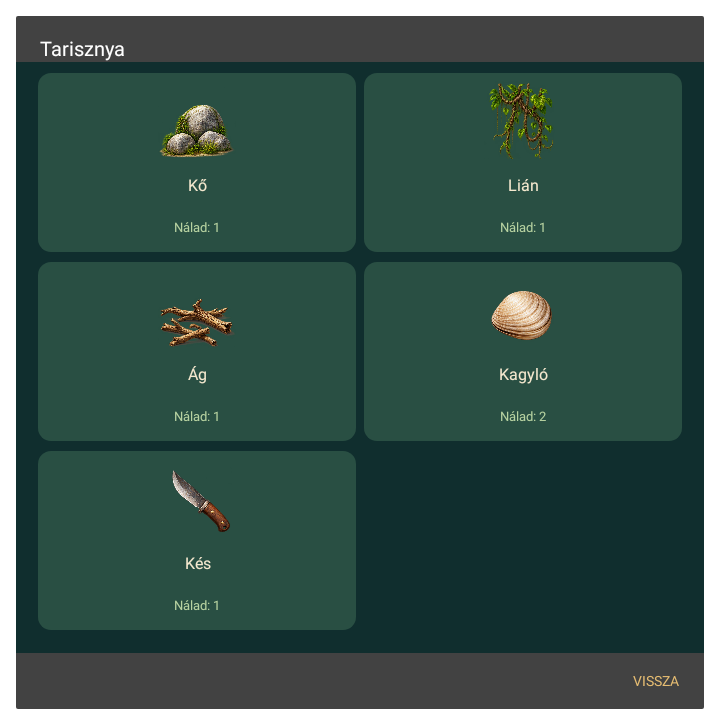

# Crusoe – saját motoros Android-játék

**0.6.0-native-alpha:** önálló Android-alkalmazás saját játéklogikával és Canvas-alapú rajzolással. Közvetlenül a játék főmenüje indul, nincs Java ME-kompatibilitás, emulátor, JAR-import, WebView vagy távoli tartalom. Android 8.0+ szükséges.

Ez egy bővülő játszható alap, **nem a teljes eredeti játék elkészült portja**. A korábbi emulátoros APK külön fejlesztési kísérlet volt.

## Elkészült

- Az eredeti öt, 180×180 cellás térképréteg helyi betöltése és a képernyőn látható világ rajzolása. A natív csomag rétegei bájtpontosan egyeznek az eredeti kivonattal.
- Mozgás érintőkar segítségével; érintésre rácsalapú útkeresés, látható célpont és simított kameramozgás.
- Az eredeti 120 tárgybejegyzés és 45 recept. Alapanyag-fogyasztás, megmaradó szerszámok, helyhez kötött készítés, közeli építmények és tárgyak kezelése.
- Tarisznya, készítéslista, szigettérkép és napló; ideiglenes túlélési/időmodell és tábori pihenés.
- Saját, ellenőrzőösszeggel védett mentés, automatikus és kézi mentéssel. Ez nem kompatibilis az eredeti RMS-mentéssel.
- Nagy felbontású, korábban készült grafikai alapok. A terep határai interpoláltak, a textúrák világkoordinátákhoz igazodnak. Nincs teljes szigetméretű, nagy felbontású bitmap lefoglalva.

- Saját, érintéses horgászat, hálózás és ballisztikus vadászat, eszköz- és csalifeltételekkel; új hal- és állatgrafikai atlasz. A részletes egyezések és eltérések: [MINIGAMES.md](planning/MINIGAMES.md).
- A 0.3.1-es saját motor mentése betölthető. Az Android csomagnév és az aláírás megmaradt.

- Egységes tárgyikonok a pályán és a natív menükben; külön kagyló-, gyümölcs-, gomba- és szerszámrajzok. Képes tarisznya, receptkártyák és ikonos hozzávalólista meglévő/szükséges mennyiségekkel.
- Az eredeti kezdőhely pontosítása és a kés/láda megjelenítése; a naplóban opcionális útkeresés a késhez. Részletek: [ITEM_GRAPHICS.md](planning/ITEM_GRAPHICS.md).

- Érintőkaros vadászat/horgászat és új kókuszdobáló minijáték, szög-/erőállítással, külön akciógombbal és kétujjas irányítással. Két találat/kókusz, öt kókusz/tíz dobás; első találat visszaállása 11 másodperc után. [Irányítás képekkel](docs/CONTROLS.md).
- A 0.3.1-es és a 0.5.0-s motorral készült helyi mentések betöltését is ellenőriztük.

## Ellenőrizve

A teljes Android APK lefordult JDK 21 / Gradle 9.6.0 / AGP 9.4.1 / SDK 36 környezetben. Tizenhárom Android/Skia felületi teszt átment: saját indítóképernyő és érintéses játékindítás, két portréfelbontás és térképrajzolás, érintőkaros mozgás, folytatás mentésből, a tarisznya/készítés/napló megnyitása és a szünet feloldása, valamint térképes út kijelölése és a mozgás elindulása a visszatérés után.

A külön motorvizsgálat 307 feltételt ellenőriz. Ebben szerepel az eredeti kezdőparti késhez vezető út, valódi tárgyfelvétel és fejszekészítés az eredeti pályáról gyűjtött anyagokkal, mind a 45 recept külön vizsgálata, eszközmegőrzés, hibás készítés atomikussága és sérült mentés elutasítása. Ez 307 ellenőrzési feltétel, nem 307 külön végigjátszás.

A minijátékok két felületi tesztje a műveletmenüből induló teljes horgászati érintéssort és a jutalom mentését, továbbá a háló/vadászat rajzolását, vezérlését és megszakítását ellenőrzi. A motorfeltételek a minijátékok követelményeit, fogásait és egyszeri készletmódosításait, illetve egy tényleges régi mentést is ellenőriznek.

Három további felületi teszt az eredeti kezdőhelyet, az eredeti láda melletti késhez vezető naplóbeli útkeresést és késfelvételt, 24 korábban összekeverhető tárgy tényleges képkülönbségét, valamint a natív ikonos tarisznyát és a recept részleteiből végzett készítést vizsgálja.

A 0.6.0 két további felületi vizsgálata kétujjas célzás/lövés, megszakított érintés, háttérből visszatérés, valamint érintőkaros horogmozgatás/megakasztás/felhúzás és mentés ellenőrzését adja. A 307 motorfeltétel a két helyi régi mentési bemenettel együtt értendő; új környezetben ezek a külön helyi bemenetek nélkül kimaradnak.

A DEX-vizsgálat igazolja a saját `GameActivity` jelenlétét, a Java ME- és J2ME Loader-osztályok hiányát. Az APK nem tartalmaz JAR/JAD fájlt, hálózati vagy tárhelyengedélyt nem kér. Az aláírás ellenőrzése sikeres.

## Ismert P0 blokkoló: a kövek és természetes tárgyak nem termelődnek újra

A 0.6.0-s natív alfában a felvehető erőforrás a felszedéskor kikerül a pályáról, de egyelőre **nem regenerálódik**. Felhasználói visszajelzés alapján már az összes kő elfogyott, ezért a játék továbbhaladása blokkolódott; az eredeti Java ME-játékban viszont a világ gyűjthető tárgyai újra megjelentek.

**Az eredeti respawn-időzítés és jogosult tárgytípusok még feltárandók, javítás még nem készült.** A [P0 N12 / #16](https://github.com/fuloplevente1998/Crusoe_HD-Android/issues/16) feladat megköveteli a meglévő kőhiányos mentés helyreállítását új játék kezdése nélkül, a történeti és épített objektumok duplikálásának elkerülésével. Fejlesztési részletek: [ROADMAP.md](planning/ROADMAP.md).

## Még hiányzik

A prioritásos, elfogadási feltételekkel rögzített teljes lista: [ROADMAP.md](planning/ROADMAP.md). Élő követés: [összesítő issue #4](https://github.com/fuloplevente1998/Crusoe_HD-Android/issues/4).

A teljes eredeti küldetéslánc és történeti állapotgép; a minijátékok pontos mozgása, időzítése és összes mellékhatása; az állatok szigetbeli mozgása és teljes harca; az időjárás és árapály szabályai; a sziget további területeit megnyitó speciális interakciók és a befejezés. A 13 kinyert bevezető esemény nem az összes küldetés.

A tereprétegek adatai pontosak, de a dekorációk és tárgyak grafikai hozzárendelése még közelítő; több tárgy közös illusztrációt használ. A túlélési/időmodell és az építés helyezése jelenleg egyszerűsített, az eredetihez való viselkedési egyezésük nincs igazolva. Egyes eredeti leírások és bevezető szövegek még angolul jelennek meg. A grafika és az animáció sem végleges.

Fizikai telefonos teszt még nincs. A Skia-tesztek nem bizonyítanak telefonon mért 60 FPS-t vagy alacsony RAM-használatot. Android 8-on a textúra-kompozit kompatibilitása miatt szoftveres rajzolási visszaesés lép életbe; Android 9+-on GPU-s Canvas az alapértelmezés.

## Grafikák és előnézetek



[Tárgyikonok](docs/previews/item-icons.png) · [Recept részletei](docs/previews/recipe.png) · [Kés és láda](docs/previews/knife-crate.png). A grafikai bemenetek jegyzéke: [docs/ARTWORK.md](docs/ARTWORK.md).

## Helyi fordítás

A generált grafikák a repóban, az `app/src/main/assets/art/` mappában találhatók. Az előnézeti képek a [docs/previews](docs/previews) mappában érhetők el. Az APK a [0.6.0-s tesztkiadásból](https://github.com/fuloplevente1998/Crusoe_HD-Android/releases/tag/native-v0.6.0-alpha) tölthető le. A forráság továbbra sem tartalmazza az eredeti JAR/JAD-ot, a közvetlenül kinyert nyers adatokat vagy a helyi világcsomagot. Az eredeti JAR-ból csak adatokat olvasunk ki; a játék eredeti végrehajtható osztályai nem kerülnek a natív programba.

```sh
python3 scripts/extract_original.py /private/original.jar --out private/extracted
python3 scripts/prepare_data.py private/extracted
# A generált grafikák már a repó részei: app/src/main/assets/art/
export JAVA_HOME=/path/to/jdk21
export ANDROID_HOME=/path/to/android-sdk
bash scripts/build_android.sh
```

A magyar tárgynevek opcionális helyi fordítása: `private/hu-items.json`. Hiányában a csomag az eredeti angol nevekkel épül. A reprodukcióhoz SDK 36, build-tools 36.0.0 és az első Gradle-függőségletöltéshez hálózat szükséges. Az aktív környezet proxy- és CA-beállításait meg kell őrizni.

A motorfüggőség nélküli ellenőrzés: `bash scripts/test_engine.sh`. Az Android felületi tesztek: `./gradlew testDebugUnitTest`. A projekt saját mentési formátumát a `GameEngine` kezeli; a rajzolás a `GameView`, az Android életciklusa és menük a `GameActivity`, a tiszta adatbetöltés a `GameData` feladata.
