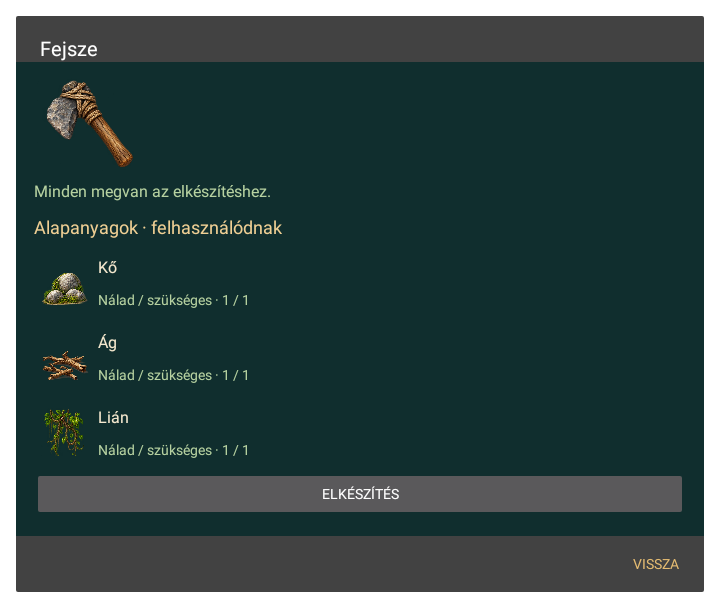

# A projekt grafikai bemenetei

A játékhoz generált rajzok, nem az eredeti JAR-ból kinyert képek. A világ, a natív tarisznya és a készítés ugyanazokat a tárgyikonokat használja. A grafikák fejlesztés alatt állnak; néhány faj és építmény még közös rajzot kap.

| Fájl | Szerep | Méret |
| --- | --- | --- |
| [objects.png](../app/src/main/assets/art/objects.png) | 16 környezeti tárgy | 1254 × 1254 |
| [robinson.png](../app/src/main/assets/art/robinson.png) | 16 járásképkocka, négy irány | 1254 × 1254 |
| [title.png](../app/src/main/assets/art/title.png) | Főmenü illusztrációja | 1672 × 941 |
| [terrain.png](../app/src/main/assets/art/terrain.png) | 16 tereptextúra | 1254 × 1254 |
| [fauna.png](../app/src/main/assets/art/fauna.png) | 16 hal- és állatrajz | 1448 × 1086 |
| [shore.png](../app/src/main/assets/art/shore.png) | 16 kagyló-, parti és gyümölcsikon | 1254 × 1254 |
| [gear.png](../app/src/main/assets/art/gear.png) | 16 szerszám- és felszerelésikon | 1254 × 1254 |
| [supplies.png](../app/src/main/assets/art/supplies.png) | 16 alapanyag- és eszközikon | 1254 × 1254 |

A fájlok SHA-256 ellenőrzőösszege: [artwork-manifest.json](artwork-manifest.json).

## Előnézetek a natív rajzolóból

[Tárgyikonok](previews/item-icons.png) · [Kés és láda](previews/knife-crate.png). Az előnézetek helyi Android/Skia felületi tesztből származnak; a tarisznya és a recept képén teszthez előkészített készlet szerepel.
