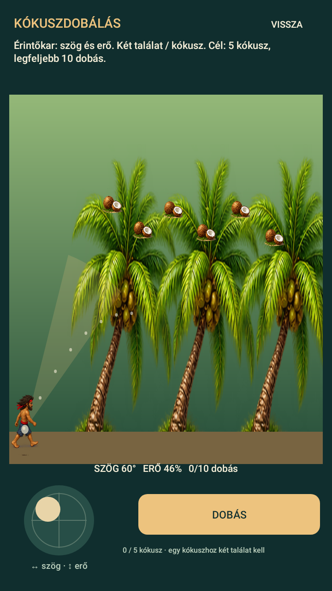

# Minijátékok irányítása – 0.6.0

| Játék | Bal oldali érintőkar | Jobb oldali gomb |
| --- | --- | --- |
| Vadászat | Bal/jobbra: szög. Fel/le: erő, így a röppálya és távolság. | Lövés |
| Kókuszdobálás | Bal/jobbra: szög. Fel/le: erő. | Dobás |
| Horgászat | A horog mozgatása két irányban. | Megakasztás, amikor a horog a halon van |
| Hálózás | Nincs szükség célzásra. | Merítés |

A kar tartásával folyamatosan állítasz, elengedéskor megmarad a célzás. A kart egy ujjal tarthatod, a gombot közben másik ujjal nyomhatod meg. A kar felengedése nem lő. A játék háttérbe küldése megszakítja az aktív érintést.

Horgászatnál kapás után felfelé mozgasd a kart, amíg a hal a felszínhez ér. A horog közvetlen húzása is működik.

Kókusz leveréséhez állj egy kókuszpálma mellé, és a Művelet menüben válaszd a „Kókusz leverése · kő” lehetőséget. Egy körhöz egy kő kell. Tíz dobásból legalább öt kókuszt kell leverni, kókuszonként két találattal. Az első találat után 11 másodpercig remeg a kókusz; ezen belül kell a második találat. A sikeres kör jutalma egy kókusz a tarisznyában.

[Horgászat](previews/fishing-joystick.png) · [Vadászat](previews/hunting-joystick.png)

A képek Android/Skia felületi tesztből készültek, irányítás-ellenőrzéshez előkészített helyzetekben. A minijátékok még fejlesztés alatt állnak; a pontos eredeti viselkedéshez viszonyított eltérések: [MINIGAMES.md](../planning/MINIGAMES.md).
